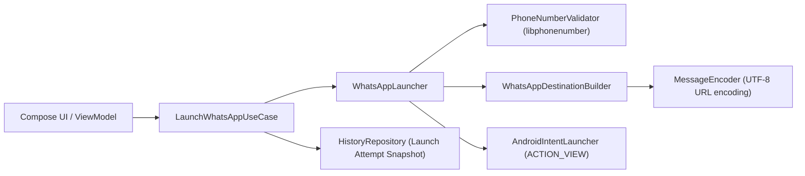
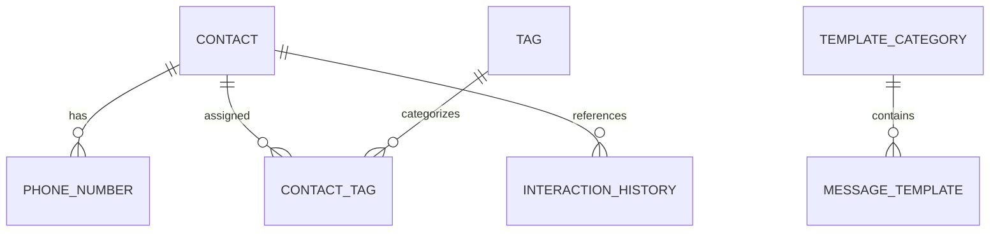

# Directline Architecture

Directline is a single-module (`:app`), local-first, offline-first Android application built with **Kotlin**, **Jetpack Compose**, **Hilt**, **Room**, and **DataStore** using a pragmatic MVVM architecture.

## Layer Responsibilities

| Layer | Package | Responsibilities |
| --- | --- | --- |
| **Presentation** | `com.directline.feature.*`, `com.directline.core.designsystem`, `com.directline.core.navigation` | Jetpack Compose screens, reusable Material 3 components, `@HiltViewModel` classes exposing immutable `StateFlow` UI state. |
| **Domain** | `com.directline.domain.*` | Pure Kotlin domain models, repository contracts, and use cases (`LaunchWhatsAppUseCase`). |
| **Data** | `com.directline.data.*` | Room & DataStore repository implementations and entity-to-domain mappers. |
| **Core** | `com.directline.core.*` | WhatsApp Click to Chat pipeline, `libphonenumber` validation, template processor, CSV processor, incoming share extractor, Room DB, DataStore. |
| **DI** | `com.directline.di` | Hilt `@Module` bindings (`DatabaseModule`, `RepositoryModule`, `WhatsAppModule`). |

## WhatsApp Integration Pipeline

WhatsApp logic is strictly isolated from the UI and ViewModels:

## Database Schema (Room)

- Deleting a contact cascades to its `phone_numbers` and `contact_tags` rows.
- Deleting a contact sets `interaction_history.contactId` to `NULL` (`ON DELETE SET NULL`), preserving `phoneNumberSnapshot` and `contactNameSnapshot`.
- Deleting a template category sets `message_templates.categoryId` to `NULL`.

## Navigation

Bottom navigation provides direct access to 5 top-level tabs:

1. **Home** — Primary WhatsApp Launcher, favorites strip, and recent destinations.
2. **Contacts** — Local contacts, multiple phone numbers, tags, notes, and favorites.
3. **Templates** — Categorized reusable templates with dynamic variable substitution.
4. **History** — Local log of WhatsApp launch attempts with quick reopen.
5. **Settings** — Theme, default country, default message draft, CSV import/export, and data deletion.
